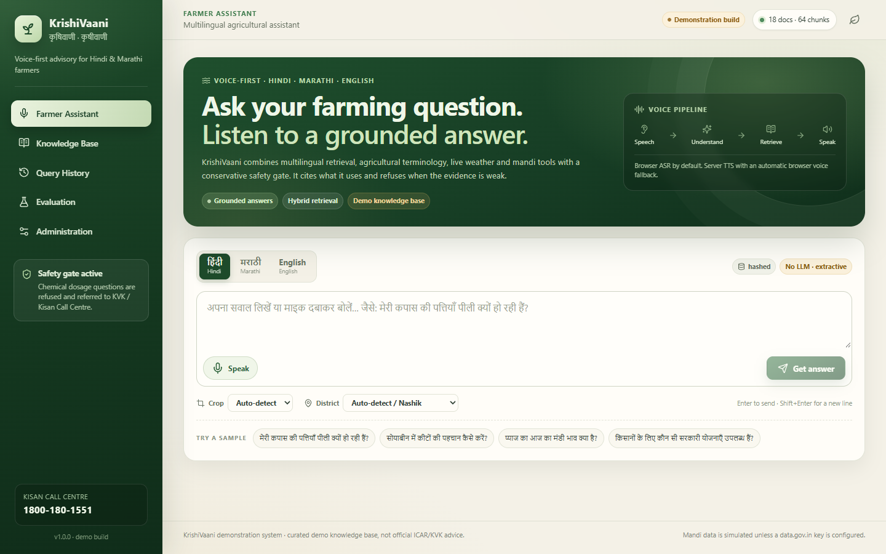

# KrishiVaani — Voice-First Multilingual Agricultural Assistant

KrishiVaani is a working, CPU-only demonstration of a voice-first agricultural
advisor for Hindi, Marathi and English speakers. It combines a local hybrid
retrieval-augmented generation (RAG) pipeline, a conservative safety gate,
labelled mandi/weather tools, speech input/output, an expert-review console and
a measured evaluation dashboard.

> **Demonstration build.** The bundled knowledge base contains 18 curated
> demonstration summaries (64 multilingual chunks), not official ICAR/KVK
> advisories. Mandi prices are simulated unless a data.gov.in key is configured.
> Weather is a live Open-Meteo forecast when the network is available. The
> default answer engine is a deterministic extractive composer, **not an LLM**.



## What works today

- **Voice-first assistant** — browser Web Speech API for Hindi/Marathi/English
  speech input, server-side `edge-tts` for spoken answers, browser
  SpeechSynthesis as a fallback. Typed input works everywhere.
- **Multilingual understanding** — transparent language identification,
  rule-based intent/entity extraction, crop/district/scheme detection and a
  66-term agricultural glossary.
- **Hybrid RAG** — BM25 + dense hashed multilingual embeddings, Reciprocal Rank
  Fusion, metadata-aware reranking and one-passage-per-document evidence
  selection, with citations and provenance.
- **Safety gate** — `ANSWER`, `ASK_TO_REPEAT` or `REFUSE`. Chemical dosage
  requests are always refused and referred to the product label, CIB&RC and
  Kisan Call Centre `1800-180-1551`.
- **Labelled tools** — mandi price tool (simulated fixture by default, optional
  Agmarknet adapter) and weather tool (Open-Meteo live, labelled fallback).
- **Five views** — Farmer Assistant, Knowledge Base, Query History, Evaluation
  and Administration.
- **Knowledge governance** — text/Markdown/PDF upload, pending review, approval,
  re-indexing, rejection, deletion, title-based major versions, duplicate-content
  detection, source register and audit log. Admin mutations require sign-in.
- **Measured evaluation** — a bundled 50-case set covering answerable, tool,
  ambiguous, unanswerable and adversarial questions across English, Hindi and
  Marathi. Run it locally to generate current measured results.
- **Tests** — 14 backend API/pipeline tests, all passing, plus a live API
  smoke-test script (`scripts/smoke_test.py`).

## Quick start (Windows)

Prerequisites: Python 3.11+ and Node.js 20+.

```powershell
cd agri_assistant
python -m venv .venv
.\.venv\Scripts\python -m pip install --upgrade pip
.\.venv\Scripts\python -m pip install -r backend\requirements.txt

cd frontend
npm ci
npm run build
cd ..

copy .env.example .env
.\scripts\start.ps1
```

If the virtual environment already exists, rebuild and start without reinstalling:

```powershell
cd agri_assistant\frontend
npm run build
cd ..
.\.venv\Scripts\python.exe -X utf8 -m uvicorn app.main:app --app-dir backend --host 127.0.0.1 --port 8000
```

Open <http://127.0.0.1:8000>. The FastAPI process serves the built React app and
the API from the same origin.

### Development mode (hot reload)

```powershell
# Terminal 1 — API
cd backend
python -m uvicorn app.main:app --reload --port 8000

# Terminal 2 — Vite
cd frontend
npm run dev
```

Open <http://127.0.0.1:5173>. Vite proxies `/api` to `127.0.0.1:8000`.

### Linux/macOS

```bash
cd agri_assistant
python3 -m venv .venv
source .venv/bin/activate
pip install -r backend/requirements.txt
(cd frontend && npm ci && npm run build)
cp .env.example .env
./scripts/start.sh
```

## Docker

```bash
cd agri_assistant
cp .env.example .env        # optional; defaults work without keys
docker compose up --build

# `.env` is optional: docker-compose.yml marks it `required: false`.
```

Open <http://127.0.0.1:8000>. The SQLite database and generated TTS cache live
in a mounted `backend/data` volume so they survive container restarts.

## Project structure

```text
agri_assistant/
├── backend/
│   ├── app/
│   │   ├── api/                 # FastAPI routers: assistant, knowledge, admin, evaluation
│   │   ├── services/            # pipeline, retrieval, gate, generation, tools, speech, eval
│   │   ├── config.py            # environment-driven settings
│   │   ├── db.py                # SQLite schema and CRUD
│   │   ├── main.py              # app factory, CORS, static SPA serving
│   │   └── evaluation.py        # CLI evaluation runner
│   ├── data/                    # seed corpus, glossary, eval set, SQLite DB (generated)
│   ├── tests/                   # 14 API/pipeline tests
│   └── requirements.txt
├── frontend/
│   ├── src/pages/               # five views
│   ├── src/components/          # shared UI primitives
│   └── src/styles.css           # responsive agricultural dashboard theme
├── docs/                        # architecture, API, deployment, user guide, sources, limitations
│   └── screenshots/             # genuine 1440×900 Playwright captures
├── scripts/                     # setup/start/test helpers (PowerShell + Bash)
├── Dockerfile
├── docker-compose.yml
└── .env.example
```

## Honesty matrix

| Capability | Default | Optional upgrade | Honest label in the UI |
|---|---|---|---|
| Answer generation | Deterministic extractive template composer | OpenAI-compatible or Ollama, grounding-checked | `template-grounded-v1 (no LLM)` |
| Embeddings | Deterministic hashed multilingual vectors | Sentence Transformers | `hashed` / provider name |
| ASR | Browser Web Speech API | `faster-whisper` server adapter | `browser` / 503 if unavailable |
| TTS | `edge-tts` (network) | Browser SpeechSynthesis fallback | provider reported per request |
| Mandi | Deterministic simulated fixture | data.gov.in Agmarknet adapter | `SIMULATED` / `LIVE` in every answer |
| Weather | Open-Meteo live forecast | `WEATHER_PROVIDER=demo` | `LIVE` only on success, else labelled fallback |
| Knowledge base | 18 curated demo summaries | Admin uploads after approval | `Demo summary` / `Admin source` |

No mock is presented as live. No key is required for the default demo.

## Tests and evaluation

```powershell
# Backend tests
cd backend
python -m pytest

# Re-run the 50-case evaluation from the CLI
python -m app.evaluation

# Or use the Evaluation view and press “Run evaluation”
```

The evaluation runner writes local results to `docs/EVALUATION_REPORT.md` and
`docs/evaluation_latest.json` with measured values from the current machine.
The generated Markdown report is not versioned. The runner does not use an LLM
judge.

## Documentation

- [ARCHITECTURE.md](docs/ARCHITECTURE.md) — components, data flow, Mermaid diagrams, scoring
- [API_DOCUMENTATION.md](docs/API_DOCUMENTATION.md) — every endpoint with examples
- [USER_GUIDE.md](docs/USER_GUIDE.md) — farmer and administrator workflows
- [architecture.mmd](docs/architecture.mmd) — standalone Mermaid source

## Demo sequence (5 minutes)

1. **Home** — point out the voice pipeline, language tabs, demo badges and the
   Kisan Call Centre number in the sidebar.
2. **English answer** — ask “Why are the leaves of my cotton crop turning yellow?”
   Show the grounded answer, citations, confidence breakdown and provenance.
3. **Hindi/Marathi** — switch to हिंदी or मराठी, ask the same question, press
   **Listen** to hear the `edge-tts` voice.
4. **Safety** — ask “What is the exact dose of imidacloprid to spray on cotton?”
   Show the refusal, safety note and KVK/KCC referral.
5. **Tools** — ask “What is the current onion mandi price?” and point out the
   `SIMULATED` label; ask “Will it rain in Nashik today?” and point out `LIVE`
   when the network succeeds.
6. **Knowledge Base** — upload a short text note, show it is pending, approve it,
   then ask a question that retrieves it. Delete the test note afterwards.
7. **History** — open a query, inspect evidence and save an expert review.
8. **Evaluation** — press **Run evaluation** and show the measured metrics and
   the explicit “not measured” notes.
9. **Administration** — show runtime providers, safety thresholds, glossary and
   the source register.

## License and data use

The application code is provided for demonstration and evaluation. The bundled
knowledge summaries are original demonstration text compiled from public
agricultural and government guidance; they are **not** verbatim copies of
official documents and must not be treated as official advice. Verify all
agronomic, chemical, scheme and market information against current official
sources before acting, and follow each publisher's terms when reusing material.
