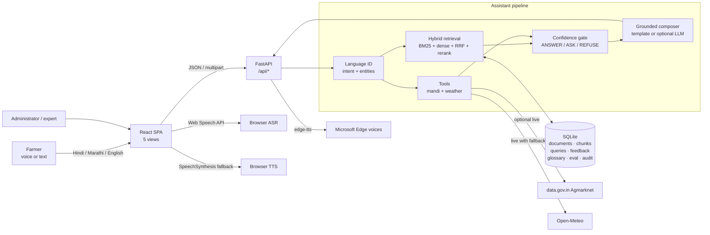
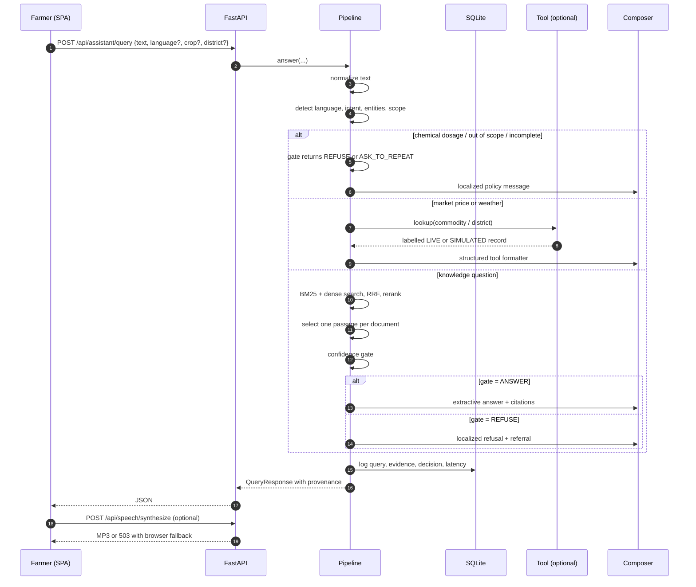
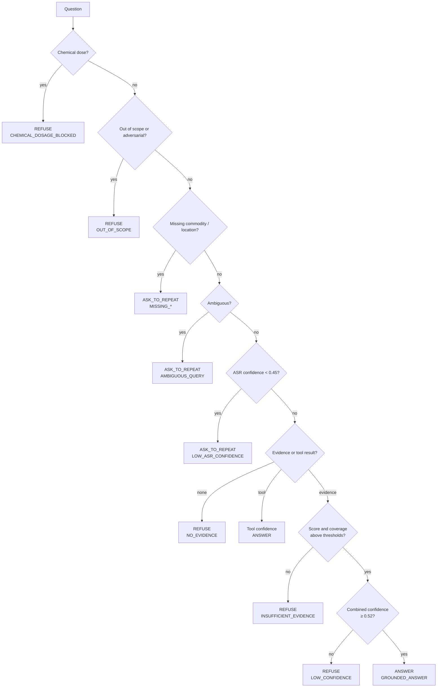
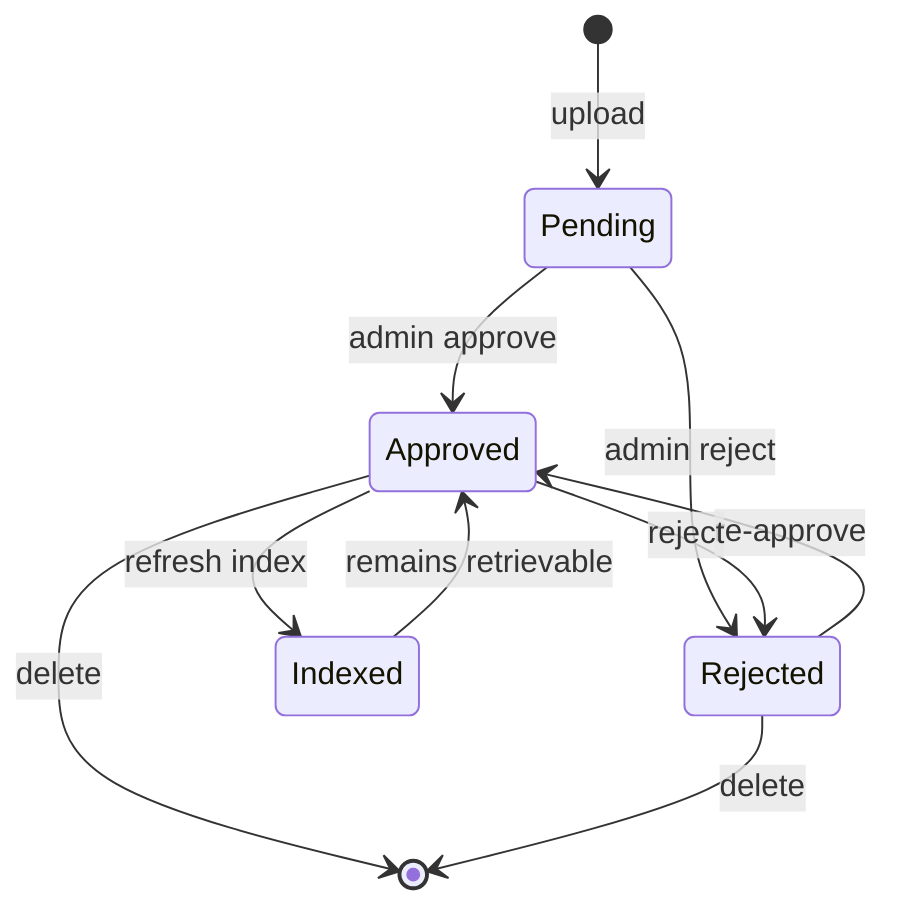
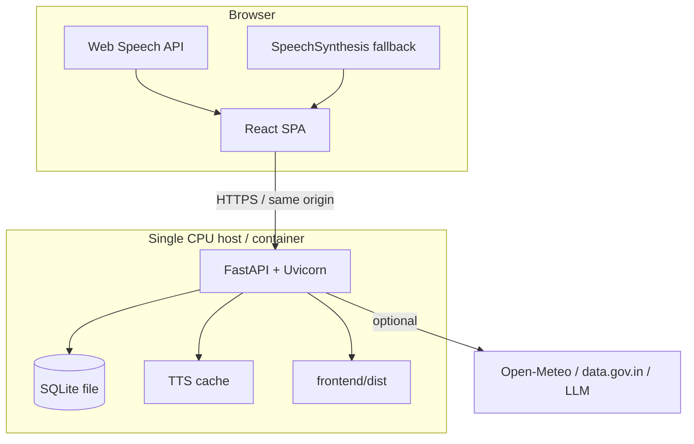

# Architecture

KrishiVaani is a single-process, CPU-only web application. A FastAPI backend
owns the pipeline, storage, tools and speech adapters; a React single-page app
provides five views. The default deployment serves the built SPA from FastAPI on
port 8000, so there is one origin and no CORS problem in production.

## 1. System context



### Design constraints

- Runs on an ordinary laptop with no GPU.
- No external service is required for the core demo.
- Every optional integration degrades to a clearly labelled deterministic path.
- Every answer reports its provider, evidence and data mode.
- Safety wins over coverage: refusing is preferred to guessing.

## 2. Request lifecycle



## 3. Components

### 3.1 Frontend (`frontend/src`)

| File | Responsibility |
|---|---|
| `App.jsx` | Shell, navigation, health/config bootstrap, error screen |
| `pages/Assistant.jsx` | Composer, language tabs, browser ASR, TTS playback, answer card, citations, feedback, session strip |
| `pages/KnowledgeBase.jsx` | Document list, filters, upload modal, detail modal, approve/reject/delete, re-index |
| `pages/QueryHistory.jsx` | Query table, filters, detail modal, evidence inspection, expert review form |
| `pages/Evaluation.jsx` | Latest metrics, per-language/category results, case table, run button, report links |
| `pages/Administration.jsx` | Runtime providers, safety policy, glossary CRUD, audit log, source register |
| `api.js` | Fetch wrapper, error normalization, formatting helpers |
| `components/ui.jsx` | Badges, stat cards, modal, confidence meter, empty states |
| `styles.css` | Responsive agricultural dashboard theme |

The SPA uses React 19, Vite 6, React Router 7 and Lucide icons. It has no UI
component library dependency; the visual system is hand-written CSS.

### 3.2 API layer (`backend/app/api`)

| Router | Prefix | Purpose |
|---|---|---|
| `assistant.py` | `/api` | Query, history, feedback, tools, speech |
| `knowledge.py` | `/api/knowledge` | Document CRUD, upload, approval, re-index |
| `admin.py` | `/api/admin` | Overview, queries, refusals, review, feedback, glossary, audit, system, safety, sources |
| `evaluation.py` | `/api/evaluation` | Dataset, runs, latest, run, report, JSON |

`main.py` adds `/api/health`, `/api/config`, `/api/samples`, CORS, a global
exception handler and static SPA serving. FastAPI's OpenAPI UI is available at
`/docs` and `/redoc`.

### 3.3 Service layer (`backend/app/services`)

| Service | Role |
|---|---|
| `container.py` | Bootstraps DB, glossary, embeddings, seed corpus, retriever, tools, composer, speech |
| `glossary.py` | 66 curated terms; variants, concepts, retrieval expansion, glossary-assisted substitution |
| `language.py` | Devanagari/Marathi/Hindi function-word and romanised-cue heuristic |
| `query_understanding.py` | Intent keywords, entities, dosage/out-of-scope patterns, ambiguity/slot checks |
| `embeddings.py` | Deterministic hashed multilingual vectors; optional Sentence Transformers |
| `ingestion.py` | Seed loading, cleaning, chunking, PDF/TXT/MD parsing, upload persistence |
| `retrieval.py` | In-memory BM25 + dense index, RRF, rerank, evidence selection |
| `confidence.py` | Coverage, combined confidence and the three-way safety gate |
| `generation.py` | Localized template composer, tool formatter, policy messages, optional LLM |
| `mandi.py` | Simulated deterministic fixture; optional data.gov.in adapter |
| `weather.py` | Open-Meteo adapter with cached, labelled demo fallback |
| `speech.py` | `edge-tts` synthesis and optional `faster-whisper` transcription |
| `pipeline.py` | Orchestrates understanding, routing, retrieval, gate, generation, logging |
| `evaluation.py` | Runs the 50-case set, computes metrics, writes report/JSON |

## 4. Retrieval design

### 4.1 Index construction

At startup, and after any approval/upload/glossary change, the retriever loads
**approved** chunks from SQLite and builds:

- an inverted term-frequency structure for BM25 (`k1=1.5`, `b=0.75`);
- a dense matrix of L2-normalized vectors (`384` dimensions by default);
- per-chunk metadata (document, language, crop, state, category, authority).

Chunks are produced per language field (`content_en`, `content_hi`,
`content_mr`). The demo corpus yields 64 chunks from 18 documents.

### 4.2 Query processing

1. Normalize Unicode and whitespace.
2. Detect language unless the UI selector overrides it.
3. Tokenize, add Devanagari stem variants and glossary concepts.
4. Compute BM25 and cosine scores over all approved chunks.
5. Fuse rankings with Reciprocal Rank Fusion:

```text
RRF(chunk) = Σ 1 / (k + rank_i),  k = 60
```

6. Rerank candidates with a transparent weighted score:

```text
final = 0.30 · coverage
      + 0.24 · dense_norm
      + 0.16 · bm25_norm
      + 0.10 · crop_match
      + 0.07 · language_match
      + 0.05 · category_match
      + 0.04 · authority
      + 0.04 · title_overlap
```

Soft penalties apply when crop or state metadata does not match (`×0.92` and
`×0.96`). Metadata is never a hard filter by default, so cross-lingual and
broad questions still retrieve useful evidence.

7. Select evidence: at most one passage per document, stopping when the next
   candidate falls below `max(0.05, 0.78 × best_score)`. This prevents parallel
   language chunks from filling every slot.

### 4.3 Why hashed embeddings?

The default embedder combines word features, character 3/4-grams, adjacent
token pairs and glossary concepts, hashed into 384 signed dimensions. It is
deterministic, fast, CPU-only and requires no model download. Glossary concepts
provide cross-lingual bridges (`कापूस`/`कपास` → `cotton`). It is **not** a
neural semantic model and will not capture arbitrary paraphrase. Set
`EMBEDDING_PROVIDER=sentence-transformers` to use a multilingual neural model
when it is installed; the app reports a fallback if loading fails.

## 5. Safety gate



### 5.1 Confidence formulas

Knowledge answer:

```text
retrieval_confidence = 0.45 · clamp(top_score)
                     + 0.35 · clamp(coverage)
                     + 0.15 · min(1, evidence_count / 3)
                     + 0.05 · source_quality

overall = 0.58 · retrieval_confidence
        + 0.27 · intent_confidence
        + 0.10 · source_quality
        + 0.05 · asr_component
```

Tool answer:

```text
overall = 0.65 · tool_confidence
        + 0.25 · intent_confidence
        + 0.10 · asr_component
```

`tool_confidence` is `0.93` for live data and `0.86` for simulated data.
Thresholds are configurable: `MIN_RETRIEVAL_SCORE=0.30`,
`MIN_EVIDENCE_COVERAGE=0.22`, `MIN_ANSWER_CONFIDENCE=0.52`.

### 5.2 Chemical dosage policy

Dosage detection combines quantity patterns (`ml`, `litre`, `gram`, `per acre`,
`मात्रा`, `किती मात्रा`) with chemical context (pesticide, insecticide, spray,
fertilizer, `कीटकनाशक`, `फवारणी`). Pure water/irrigation quantities are excluded.
A match short-circuits to `REFUSE` before retrieval. The response never contains
a dose number; it refers to the product label, CIB&RC and KVK/Kisan Call Centre.

## 6. Generation

The default `GroundedComposer`:

1. Prefers evidence in the answer language.
2. Selects and joins extractive sentences from approved evidence.
3. Adds a localized source line and demo/safety note.
4. Produces citations with title, publisher, date, URL, licence, excerpt and
   `is_demo` status.
5. Reports `template-grounded-v1 (no LLM)` and `deterministic-fallback`.

If `LLM_PROVIDER=openai` (or `openai-compatible`) with `OPENAI_API_KEY`, or
`LLM_PROVIDER=ollama`, the composer requests a grounded answer with the
evidence in the prompt. The output is accepted only if:

- it is non-empty,
- lexical grounding against the evidence is at least `0.45`,
- it does not contain unsafe dosage-like content.

Otherwise the template answer is used and `llm_fallback_reason` is set. The API
always reports the provider that actually produced the answer.

## 7. Tools

### Mandi

- **Default:** deterministic simulated fixture seeded by
  `date + commodity + market`. Prices vary by day but are not live. Every answer
  contains `SIMULATED` and “not a live quote”.
- **Live:** set `MANDI_PROVIDER=data_gov_in` and `DATA_GOV_IN_API_KEY`. The
  adapter queries the Agmarknet resource on data.gov.in, selects the requested
  market when possible and labels the result `LIVE` with the arrival date.
- Network/credential/parse failure falls back to the simulated fixture with an
  explicit `fallback_reason`.

### Weather

- **Default:** Open-Meteo current conditions and a 3-day forecast for 15
  Maharashtra districts. Labelled `LIVE` only when the request succeeds.
- **Fallback:** deterministic demo fixture labelled `SIMULATED` with the failure
  reason. Results are cached for 10 minutes.
- Open-Meteo is a free forecast API, **not** an official IMD Agromet bulletin.

## 8. Storage model

SQLite in WAL mode, with short-lived connections. Tables:

| Table | Key data |
|---|---|
| `documents` | Multilingual title/content, publisher, source URL/date, licence, category, crops, states, approval, demo flag, chunk count |
| `chunks` | Document ID, index, language, text, embedding BLOB, metadata |
| `queries` | Text, detected language, intent/confidence, entities, decision, confidence, reason, answer, evidence, tool data, signals, latency, provider, review |
| `feedback` | Query ID, rating, comment, review status |
| `glossary` | English/Hindi/Marathi term, category, aliases, notes |
| `eval_runs` | Dataset version, metrics, case results, duration, status, notes |
| `audit_log` | Actor, action, entity, detail, timestamp |

The database path defaults to `backend/data/agrivaani.db`. Delete the file to
re-seed the demo corpus on the next start. `AGRI_DB_PATH` is resolved relative to
the project root, so the app behaves the same from any working directory.

## 9. Ingestion and governance



- Accepted files: `.txt`, `.md`, `.markdown`, `.pdf` (text PDFs only; scanned
  PDFs need OCR, which is not enabled).
- Uploads are cleaned, language-detected, chunked per language and embedded.
- Pending/rejected documents are stored but excluded from retrieval.
- Approval and deletion trigger an in-memory index rebuild.
- Original uploads are retained under `backend/data/uploads/` for auditability.
- Every upload, status change, deletion, glossary change and feedback review is
  written to the audit log.

## 10. Evaluation

The runner executes the 50 bundled cases through the real pipeline, collects
decision/intent/retrieval/faithfulness/latency results, aggregates metrics and
writes:

- `docs/EVALUATION_REPORT.md`
- `docs/evaluation_latest.json`

Faithfulness is a **lexical support heuristic**: answer content tokens are
compared with retrieved evidence after removing template scaffolding, source
lines, demo/safety notes. It is not RAGAS and not an LLM judge. Retrieval metrics
are document-level. Latency is in-process and excludes ASR/TTS/network/LLM time.

## 11. Deployment topology



This is a demonstration topology: one process, no authentication, no queue and
no horizontal scaling. Do not treat it as a production design.

## 12. Key trade-offs

| Choice | Benefit | Cost |
|---|---|---|
| SQLite + in-memory index | Zero infrastructure, fast demo | Single writer, rebuild on change, not cluster-ready |
| Hashed embeddings | Offline, deterministic, CPU-only | Weaker semantic recall than a neural model |
| Rule-based understanding | Auditable, no training data | Limited paraphrase and code-mixing coverage |
| Extractive composer | Grounded by construction | Less fluent than an LLM; repeats source phrasing |
| Conservative gate | Fewer unsafe answers | More refusals/clarifications on edge cases |
| Demo corpus | Reproducible evaluation | Not official or comprehensive |
| One-process SPA serving | Simple deployment | No CDN, no independent frontend scaling |
